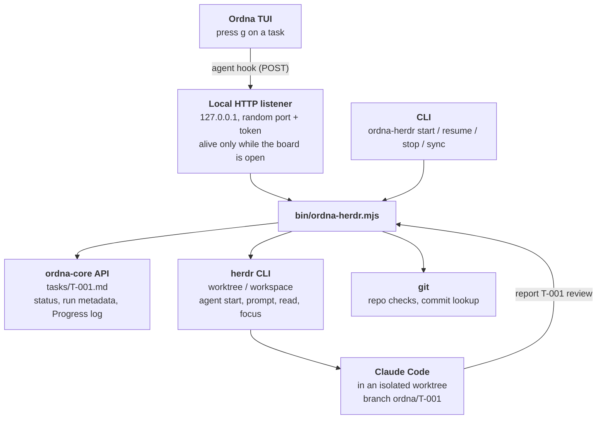

# ordna-herdr-bridge

A central, Git-versioned task board for many projects, with a small bridge that hands any task to [Claude Code](https://claude.com/claude-code) running inside [Herdr](https://herdr.dev).

- **[Ordna](https://ordna.sh/)** keeps the tasks: one Markdown file per task, the Kanban board is derived from them, Git is the history.
- **Herdr** keeps the sessions: one workspace and one named agent per task, persistent and resumable.
- **`ordna-herdr`** (this repo, ~400 lines of dependency-free Node) glues them together: pick a task in the Ordna TUI, press `g`, and Claude Code starts working on it in an isolated Git worktree of the right project.

Tasks live in this repository, **separate from your code repositories**. Adding a project is one line of config, no code changes.

> **Status:** works end to end on Windows 11 (PowerShell 7), including repositories inside WSL. See [Tested](#tested-and-not-tested) for exactly what has and has not been verified.

## How it works



Design rules:

- **Native first.** The Ordna side uses its built-in agent hook (`ORDNA_AGENT_HOOK_URL`); the Herdr side uses only documented CLI commands. No database, no permanent service, no Docker, no npm dependencies.
- **A task is never "done" because the agent went idle.** The agent reports `review` explicitly; `done` is always a human decision.
- **No surprises in your repos.** Work happens in a dedicated worktree and branch (`ordna/T-001`). The bridge never pushes, merges or deletes, and refuses to run in a dirty repository when isolation is off.

## Requirements

| Tool | Tested with | Notes |
|---|---|---|
| [Ordna CLI](https://github.com/FreHilm/ordna) (`@frehilm/ordna-cli`) | 0.4.0 | `storage: file` |
| [Herdr](https://herdr.dev) | 0.9.5 | server running, Claude Code integration set up |
| Claude Code | 2.1.x | |
| Git | 2.45 | |
| Node.js | 24 | the bridge uses only built-ins |
| PowerShell | 7.6 | only for the `ordna-herdr.ps1` shim; call `node bin/ordna-herdr.mjs` directly otherwise |

The bridge imports `ordna-core` from the global npm install of the Ordna CLI (`%APPDATA%\npm\node_modules\@frehilm\ordna-cli\...`). With a different install location, set `ORDNA_CORE` to the full path of `ordna-core/dist/index.js`.

## Setup

```powershell
git clone git@github.com:spinellifabio/ordna-herdr-bridge.git
cd ordna-herdr-bridge

# 1. Ordna config is already in .ordna/config.yaml (storage: file + the status set below).
# 2. Create your local project registry (not versioned):
Copy-Item projects.json.example projects.json    # then edit, or just use `project add`

# 3. Optional alias
Set-Alias oh "$PWD\ordna-herdr.ps1"
```

Statuses (`.ordna/config.yaml`): `todo → in-progress → blocked → review → done`. The last one is Ordna's terminal status, so Ordna refuses `done` while a `depends_on` task is not done.

## Quick start

```powershell
# Register a project (must be a Git repository)
oh project add myapp C:/src/myapp --name "My App"

# Create a task. Inside a registered repo the project tag is inferred from the directory:
cd C:\src\myapp
oh create "Add retry to the HTTP client" -p high

# Fill in Goal / Acceptance Criteria (tasks/T-001.md, or `e` in the TUI), then hand it over:
oh board            # select the task, press g
# or without the TUI:
oh start T-001

oh status           # Ordna state + live Herdr state
oh show T-001       # same, and focuses the agent's Herdr session
```

When Claude finishes and verifies the work it runs `report T-001 review --note "..."`. You review branch `ordna/T-001`, integrate it yourself, then:

```powershell
ordna move T-001 done      # from inside ordna-herdr-bridge
ordna commit -m "tasks: T-001 done"
```

## Commands

Run as `ordna-herdr.ps1 <command>` (or `node bin/ordna-herdr.mjs <command>`). All commands work from any directory.

| Command | What it does |
|---|---|
| `board` | Opens the Ordna TUI with the agent hook wired to a local listener. **`g`** on a task = `start`. |
| `create <title…> [-P project] [-p high\|medium\|low] [-t tag…]` | Creates a task in the central repo. Project defaults to the registered repo containing the current directory (subfolders and worktrees included). |
| `start <id>` | Creates the worktree, opens a Herdr workspace, starts agent `ordna-<id>`, sends the task. Refuses if the agent already exists. |
| `resume <id>` | Live agent: focuses it (or delivers a still-pending prompt). Dead agent: reopens the worktree and runs `claude --resume <session>`. |
| `stop <id>` | Sends Esc to the agent; task becomes `blocked`. Does not close panes or delete anything. |
| `status [id]` | Task status plus the live Herdr agent state, branch, commit, PR, last result. |
| `show <id>` | `status` + focus the agent's session in Herdr. |
| `sync` | Reconciles Ordna with Herdr (see below). Never sets `done`. |
| `report <id> <review\|blocked\|in-progress> [--note T] [--pr URL]` | Used by the agent (and by you) to change state and record a result. |
| `project add <id> <path> [options]` / `project list` | Manage the registry. `add` validates that the path is a Git repo. |
| `gc` | Removes orphaned `*.worktrees/<id>` entries from Git's global `safe.directory` (WSL only, see below). |

Plain `ordna …` commands (list, show, move, assign, commit, web) keep working **inside `ordna-herdr-bridge`**; they operate on the current directory only.

## Task lifecycle

| Event | Status |
|---|---|
| Task created | `todo` |
| `start` / `g` succeeded | `in-progress`, assignee `claude` |
| Start or prompt failed, agent waiting on a startup dialog, session died without a report (`sync`), `stop` | `blocked` |
| Agent runs `report … review` | `review` |
| Human approval | `done` (always manual) |

Per run, the bridge stores this in the task frontmatter (Ordna preserves unknown keys) and appends each event to `## Progress`:

`project`, `herdr_agent`, `herdr_workspace`, `herdr_pane`, `branch`, `worktree`, `claude_session`, `prompt_sent`, `commit`, `pr`, `result`, `run_started_at`.

`sync` marks `in-progress` tasks whose agent vanished as `blocked`, marks tasks whose agent is waiting for input (Herdr state `blocked`) as `blocked`, and refreshes `commit`. Ordna emits no events on state changes, so `sync` is manual.

## Project registry

`projects.json` is local to your machine and git-ignored. The task's project is the task tag that equals a registry id (exactly one must match).

```json
{
  "projects": {
    "myapp": {
      "name": "My App",
      "path": "C:/src/myapp",
      "agent": "claude",
      "isolation": "worktree",
      "baseRef": "main",
      "instructions": "Appended to the prompt of every task of this project.",
      "agentArgs": [],
      "trustRepository": false,
      "trustWorktrees": false
    }
  }
}
```

| Field | Default | Meaning |
|---|---|---|
| `path` | required | Local Git repository (forward slashes; `//wsl.localhost/<distro>/...` for WSL). |
| `name` | id | Display name used in Herdr workspace labels. |
| `agent` | `claude` | Herdr agent kind. Only Claude Code has been tested. |
| `isolation` | `worktree` | `worktree`: a dedicated branch `ordna/<id>` in its own worktree. `none`: work in the repo itself, refused if it has local changes. |
| `baseRef` | `HEAD` | Ref the task branch starts from. |
| `instructions` | – | Extra text added to every task prompt. |
| `agentArgs` | `[]` | Extra arguments passed to `claude`. |
| `trustRepository` | `false` | Passes `--trust-repository` to Herdr worktree commands. Enable only for repos you verified. |
| `trustWorktrees` | `false` | WSL only, see below. |

`project add <id> <path> [--name N] [--isolation worktree|none] [--instructions T] [--base-ref R] [--trust-worktrees]` writes this file for you (and creates it if missing).

## Using it from your project repos and from Claude

`ordna-herdr` resolves everything with absolute paths, so `create`, `start`, `status`, `report`… work from any directory, and the agent can call `report` from inside its worktree. Plain `ordna` does **not** (it looks for `.ordna/config.yaml` in the current directory).

To make other Claude Code sessions aware of the central board, add a short note to your global `~/.claude/CLAUDE.md`, e.g.:

```md
## Central tasks (Ordna)
Tasks live in <path-to>/ordna-herdr-bridge, not in the current repo. Create with
`<path-to>/ordna-herdr.ps1 create "Title" [-p high] [-t tag]` (project inferred from cwd, `-P <id>` elsewhere).
Never move a task to `done`, push or merge without an explicit request.
```

## Repositories inside WSL

Register them with the UNC path (`oh project add app //wsl.localhost/Ubuntu/home/me/app`). From a WSL shell, call the Windows shim:

```bash
oh() { powershell.exe -NoProfile -File 'C:\path\to\ordna-herdr-bridge\ordna-herdr.ps1' "$@"; }
```

What differs from a Windows repo:

- Herdr runs Windows `git.exe`, which rejects WSL repositories ("dubious ownership"). The bridge therefore runs `git` through `wsl.exe` and creates the worktree itself with `git worktree add` in `<repo>.worktrees/<id>` (next to the repo, outside its tree). Herdr only opens a workspace there.
- Claude Code runs as a Windows process on a UNC path, so Windows Git must trust the worktree or the agent cannot use `git`. `safe.directory` matches exact paths only (no wildcards, no recursion), and every task has a new worktree path. Options:
  - `"trustWorktrees": true` on the project: the bridge adds **only the exact worktree path it just created** to your global `safe.directory`. It never touches other entries.
  - Without the flag, it prints the `git config --global --add safe.directory …` command for you to run.
  - `ordna-herdr gc` removes entries for worktrees that no longer exist (only entries ending in `.worktrees/<id>`).
- Only `isolation: worktree` is supported for WSL repositories.

## Safety

- No `push`, `merge` or branch/worktree deletion is ever performed by the bridge. The agent prompt forbids them too.
- Tasks and logs never contain credentials; the hook token exists only in the environment of the board process and is checked on every request (loopback only).
- Concurrent starts are prevented twice: Herdr agent names are unique (`ordna-t-001`), and a lock file in `.ordna/run/` guards the start sequence.
- Child processes are spawned with argument arrays, never through a shell string, so paths with spaces are safe.
- Claude Code's "do you trust this folder?" dialog for a new worktree is **never auto-approved**. The task becomes `blocked`; approve it in the Herdr pane, then run `resume`.

## Troubleshooting

| Symptom | Fix |
|---|---|
| `agent waiting for input in pane … (startup dialog)` | Claude shows its trust-folder dialog in the new worktree. Approve it in the Herdr pane, then `resume T-xxx`. |
| `exactly one registered project tag is required` | Add or fix the project tag on the task. |
| `repository missing or not a git repo` | Wrong `path` in `projects.json`; `project list` shows `MISSING`. |
| `agent '…' is already running` | The task already has a live agent; use `show` or `resume`. |
| `worktree/pane no longer available` | The worktree was removed. Create a new task or re-create the branch. |
| Prompt pasted but not sent | The bridge re-sends Enter/the prompt up to 3 times and verifies the agent started working; if it still fails the task is `blocked` with the reason. |
| `herdr …` connection errors | Check `herdr status`; the Herdr server must be running. |
| `detected dubious ownership` (WSL) | See [Repositories inside WSL](#repositories-inside-wsl). |
| `ordna --version` prints `0.0.0` | Cosmetic bug of the Ordna 0.4.0 package. |

## Tested and not tested

Verified on Windows 11 / PowerShell 7 against throwaway repositories (a Windows one and a WSL one), with real Herdr and Claude Code sessions:

- project registration, task creation with project inference (repo root, subfolder), unknown/missing/invalid project errors
- `start`, prompt delivery, Claude's own `report review`, metadata persistence in the task file
- the TUI hook: `g` on a task in `ordna-herdr board` starting a run
- duplicate start refused, `stop`, `resume` after the pane was closed (same Claude session restored), `sync`
- missing repository, missing task, task without project, invalid state
- WSL: registration, `create` from a WSL directory, worktree creation through WSL git, agent running `git status`/`git log` after `trustWorktrees`, `gc`
- the target repositories were verified to stay untouched

Not verified:

- several tasks running at the same time on different projects
- `isolation: none`
- agents other than Claude Code
- macOS/Linux (the default `ordna-core` location and the shim are Windows-specific; use `ORDNA_CORE` and `node bin/ordna-herdr.mjs`)

## Known limitations

- Ordna's agent hook is HTTP-only and manual (`g`); Ordna does not emit events when a status changes, so live states are reconciled with `sync`.
- The listener exists only while `ordna-herdr board` is open. The TUI toast only shows "Sent" or "hook failed"; the real error is written to the task (`blocked` + `## Progress`).
- Herdr state `unknown` cannot be classified. `resume` sets `in-progress` even if the restored session is just waiting for your next prompt.
- The prompt sent to the agent is fixed text in `buildPrompt` (`bin/ordna-herdr.mjs`); per-project additions go in `instructions`.

## Repository layout

```
bin/ordna-herdr.mjs       the bridge
ordna-herdr.ps1           PowerShell shim
projects.json.example     registry template (projects.json is local, git-ignored)
.ordna/config.yaml        Ordna config (storage + statuses)
tasks/                    one Markdown file per task
```

`ordna init` also generates an `AGENTS.md` guide; it is git-ignored here.

## License

[MIT](LICENSE)
